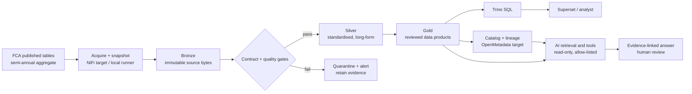

# Data & AI Fabric Engineering Architecture

## 1. Design objective

Build a governed, reusable engineering path from separately managed source data to trusted, discoverable, queryable products. The fabric is a set of interoperating capabilities and ownership practices, not a single product. Design aims: preserve source truth; publish explicit contracts; automate quality and lineage; make data portable; and expose bounded products to analytics and AI.

## 2. Local executable versus enterprise target

| Capability | Runnable local lab | Enterprise target design |
|---|---|---|
| Acquisition | Bundled, versioned FCA table extracts; checksum verification | Apache NiFi flow polls an approved publisher endpoint or controlled landing location, records provenance, retries and routes failures |
| Immutable landing | `data/bronze/` byte copies | Object storage with versioning/retention controls; write-once landing policy where required |
| Table format | CSV in the source and layer folders | Apache Iceberg tables in Parquet on object storage; catalog/REST or other supported catalog selected by platform standards |
| Transformation | Python standard library; explicit checks; SQLite materialization | Trino SQL/dbt-style governed transformations (select orchestration and SQL framework after platform constraints are known) |
| Catalog/lineage | Manifest and run JSON provide basic evidence | OpenMetadata (or approved enterprise catalog) ingests service, dataset, ownership, schema, lineage and quality metadata |
| Query/consumption | SQLite query examples | Trino with group/role-based access; Superset or existing BI platform for analyst access |
| AI | Prompt and controls documented; no live model | Approved model gateway and retrieval/tool layer limited to governed Gold views and metadata |

The enterprise services in the right column have not been installed or integrated in this portfolio. Apache NiFi's guide describes data provenance; Iceberg's specification documents table metadata/snapshots; Trino documents an Iceberg connector and authorization modes. Those sources support component capabilities, not a claim that this assembled design is already deployed or compliant.

## 3. Logical flow

## 4. Data layers and contracts

### Source / Bronze

- Capture original publication version, retrieval or extraction time, publisher URL, licence, file hash, schema/header, and reporting coverage.
- Do not rewrite or silently overwrite source bytes. Store each publication as an immutable object/version in a production lake.
- Local source CSVs are table transcriptions of FCA public HTML, not the FCA workbook binary. The manifest records extraction and SHA-256; the source notes disclose this.
- Treat an FCA correction as a new snapshot/version. Keep both versions and record the supersession relationship.

### Silver

- Convert wide period columns into one row per product/category and reporting period.
- Keep FCA labels, reporting periods, values, and nulls; add controlled technical metadata without changing business meaning.
- Keys are `(product, reporting_period)` for each metric table. Context rates are separate because the category set and denominator differ from volume data.
- Keep `opened` measures distinct from market-wide `closed` outcome measures.

### Gold data products

- `product_half_year_change`: product-level 2025 H1 to 2025 H2 change, with base count and denominator shown.
- `product_group_period_totals`: sum of source product categories grouped by FCA product group and period. Validate category completeness and definition before treating it as an official FCA total.
- Market outcomes remain a separate table; no row-level join to product records is implied.
- Product contracts state owner, purpose, grain, measures, refresh date, source, caveats, quality checks, access classification, and downstream use.

## 5. Engineering decisions and trade-offs

1. **Batch, not streaming:** FCA publishes every six months. A streaming architecture would add cost/complexity without a streaming source. In a bank target, use event/CDC patterns only for sources with genuine operational timeliness requirements.
2. **Keep immutable source versions:** enables reproducibility and revision comparison. Retention, legal hold and deletion requirements must still be designed with the data owner.
3. **Use an open table format for shared lake storage:** Iceberg provides schema/partition metadata and snapshots; use it where platform engines/catalogs are compatible. Decide catalog, version, compaction, retention and concurrency behavior through platform validation.
4. **Separate ingestion from modelling:** NiFi moves/orchestrates the flow; SQL/Python transformations are version-controlled separately. Do not bury business rules in opaque flow logic.
5. **Quality before publish:** block Gold release when contract checks fail; preserve failure details and allow controlled replay.
6. **Metadata is operational:** ownership, classifications, freshness, lineage, quality status, source revision and support route should be recorded as part of release—not left as wiki-only documentation.
7. **Expose products, not unrestricted storage:** consumer teams and AI should use approved views with explicit contracts.

## 6. Security, privacy, resilience and operations

This public dataset has no personal records. A real bank deployment must apply its own data classification and privacy assessment, identity model, least-privilege access, network and secret controls, encryption, audit logging, retention, deletion, backup/restore, and incident processes. Avoid treating this public-data demo as evidence of production security.

Operate with named service owners and on-call routes; pipeline run IDs; source checksums; freshness/volume/schema/quality signals; retry limits; dead-letter or quarantine handling; replay instructions; immutable release artifacts; tested backup/restore; and measurable SLOs agreed with consumers. Record compute/storage cost by domain/data product. Define RPO/RTO with the business rather than inventing targets.

## 7. AI pattern

The assistant receives an identity-scoped list of approved Gold views, metric definitions, and source/lineage metadata. It can ask Trino for read-only, parameterized queries against that allow-list, apply row/column policies, and return cited values with periods and caveats. It cannot access Bronze, create arbitrary SQL, expose other domains, or make decisions for customers. Log prompt/template version, user identity, tool/query, dataset snapshot, returned evidence, model version, and feedback under the organisation's AI policy. Review accuracy, unsupported claims, prompt injection, leakage, access enforcement, latency and cost before expansion.

